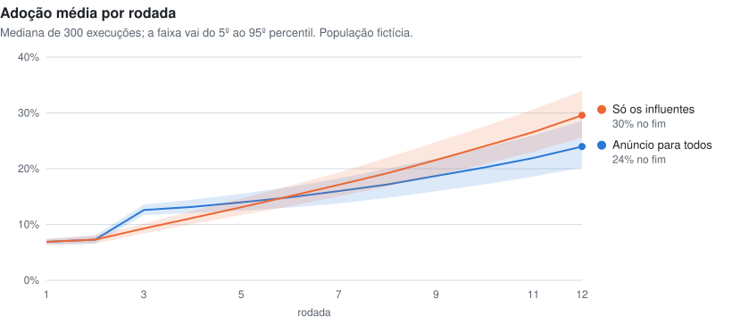
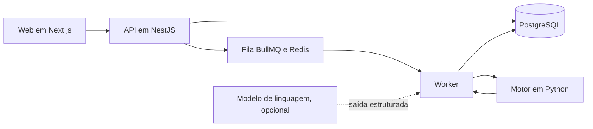

<picture>
  <source media="(prefers-color-scheme: dark)" srcset="docs/vitrine/capa-escuro.svg">
  
</picture>

Uma plataforma para testar hipóteses antes de virarem decisões. O predict cria uma população sintética, aplica um cenário, roda centenas de simulações com sementes controladas e mostra a **distribuição** dos resultados, e não uma resposta única.

> **Em construção.** O motor de simulação funciona e é testado. A API, o worker e as regras de acesso têm a base pronta. A interface é uma página de apresentação, e ainda não há login nem fluxo completo para o usuário.

## Um exemplo

Uma equipe quer lançar uma ideia e tem dois caminhos: anunciar para todo mundo ou convencer só as pessoas mais influentes.

<picture>
  <source media="(prefers-color-scheme: dark)" srcset="docs/vitrine/cenarios-escuro.svg">
  
</picture>

| Cenário | 5º percentil | Mediana | 95º percentil |
|---|---:|---:|---:|
| Anúncio para todos | 20% | 24% | 29% |
| Só os influentes | 26% | 30% | 34% |

O anúncio geral cresce mais rápido, e o caminho pelos influentes passa na frente depois da metade. As faixas ainda se encostam, e é isso que o gráfico deixa claro. Os dados são fictícios e o código está em [comparar_cenarios.py](services/simulation-engine/examples/comparar_cenarios.py).

```bash
cd services/simulation-engine
python -m examples.comparar_cenarios --saida ../../docs/vitrine
```

## Arquitetura



| Parte | Tecnologia | Situação |
|---|---|---|
| Motor de simulação | Python | Funcionando, com testes |
| API | NestJS e Prisma | Serviços e permissões testados; integração em andamento |
| Worker | BullMQ e Redis | Orquestração testada; adaptadores em andamento |
| Web | Next.js | Página de apresentação |

## Decisões

- **Reprodutível.** A mesma semente gera o mesmo resultado, e cada execução guarda o cenário que a originou.
- **A IA não manda no resultado.** O modelo de linguagem só entrega saídas estruturadas e não altera o estado da simulação.
- **Honesto com a incerteza.** Frequência simulada não é apresentada como probabilidade do mundo real.
- **Fronteiras claras.** O motor só calcula. Regras, acesso e persistência ficam na API.

## Saiba mais

- [Como rodar](docs/desenvolvimento.md)
- [Situação da implementação](docs/planning/IMPLEMENTATION_STATUS.md)
- [Decisões de arquitetura](docs/adr)

## Licença

Código visível apenas para leitura. Todos os direitos reservados: não é permitido usar, copiar ou distribuir sem autorização. Veja [LICENSE](LICENSE).
